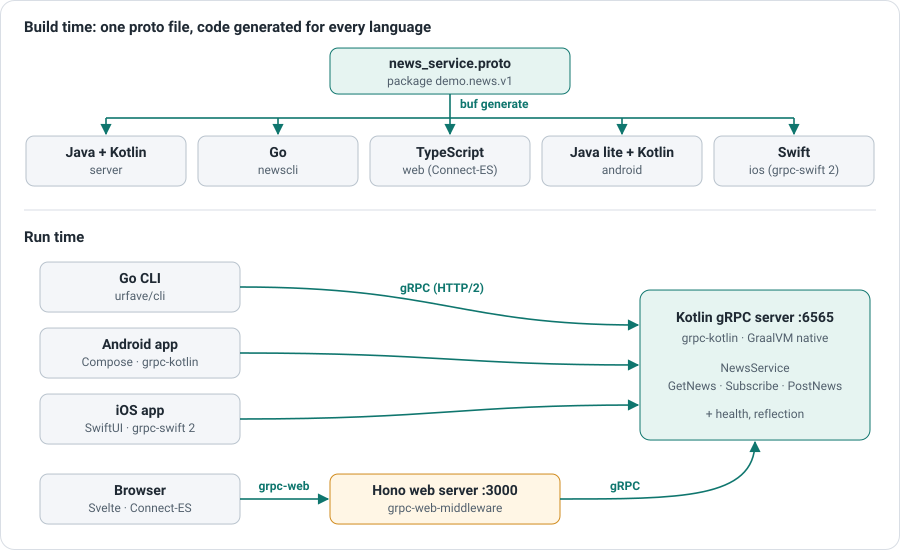

# gRPC Full Stack example

**One proto file to rule them all**: a small news service defined once in
[`news_service.proto`](proto/demo/news/v1/news_service.proto), with a server and four clients in different languages,
all generated from that file with [buf](https://buf.build/).



The service shows the two most common kinds of gRPC calls:

| RPC | Kind | Used for |
|-----|------|----------|
| `GetNews` | unary | list the news of a topic (or of every topic) |
| `PostNews` | unary | publish a news item |
| `Subscribe` | server streaming | receive news as they are published, live |

Post a news item from any client and every other client subscribed to its topic shows it immediately.

## Parts

| Part | Stack |
|------|-------|
| [Server](backends/kotlin-graal) | Kotlin, grpc-kotlin coroutines, GraalVM native image, health and reflection services |
| [Go command line client](newscli) | Go, grpc-go, urfave/cli |
| [Web application](web) | Svelte, Connect-ES (grpc-web), Hono with [grpc-web-middleware](https://github.com/fb64/grpc-web-middleware) |
| [Android application](android) | Kotlin, Jetpack Compose, grpc-kotlin over OkHttp |
| [iOS application](ios) | Swift, SwiftUI, grpc-swift 2 |

Browsers cannot make gRPC calls directly, so the web application talks grpc-web to its own Node.js server,
which forwards the calls to the gRPC server.

## Quick start

With [podman](https://podman.io/) or [Docker](https://www.docker.com/), run the server and the web application:

```sh
podman compose up --build   # or: docker compose up --build
```

Then open http://localhost:3000, and from another terminal publish a news item with grpcurl or the CLI:

```sh
grpcurl -plaintext -d '{"title":"Hello","topic":"TOPIC_TECH"}' localhost:6565 demo.news.v1.NewsService/PostNews
```

## Development

Every tool (JDK, Go, Node.js, buf, Swift on Linux, XcodeGen on macOS) is pinned in [`mise.toml`](mise.toml).
Install [mise](https://mise.jdx.dev/), then:

```sh
mise install          # install the toolchain
mise run server       # start the gRPC server on :6565
mise run web          # web application with hot reload on :5173
mise run cli -- list  # Go CLI
mise tasks            # every task: tests, lint, Android, iOS, container images...
```

The Android and iOS applications also need Android Studio or Xcode: see their READMEs.

### Changing the API

1. Edit [`proto/demo/news/v1/news_service.proto`](proto/demo/news/v1/news_service.proto).
2. `mise run proto:lint` checks it against the [buf style guide](https://buf.build/docs/best-practices/style-guide/),
   and `mise run proto:breaking` reports changes that would break existing clients.
3. `mise run generate` regenerates the code of every part ([`buf.gen.yaml`](buf.gen.yaml)). The generated code is
   committed, so each part builds on its own and can be browsed on GitHub; CI fails if it is out of date.

### Checks

`mise run lint` checks the proto files, the Go code and the web application types; `mise run test` runs the server
and CLI tests. The Android (`android:test`) and iOS (`ios:test`) tests have their own tasks, as they need their SDKs.
[CI](.github/workflows/ci.yml) runs all of them, builds the container images and makes a grpc-web call through them.
[Renovate](renovate.json) keeps the dependencies up to date.
