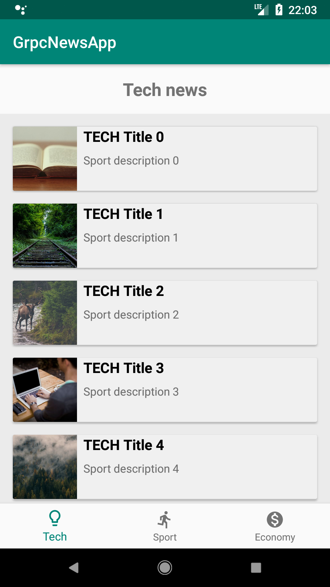
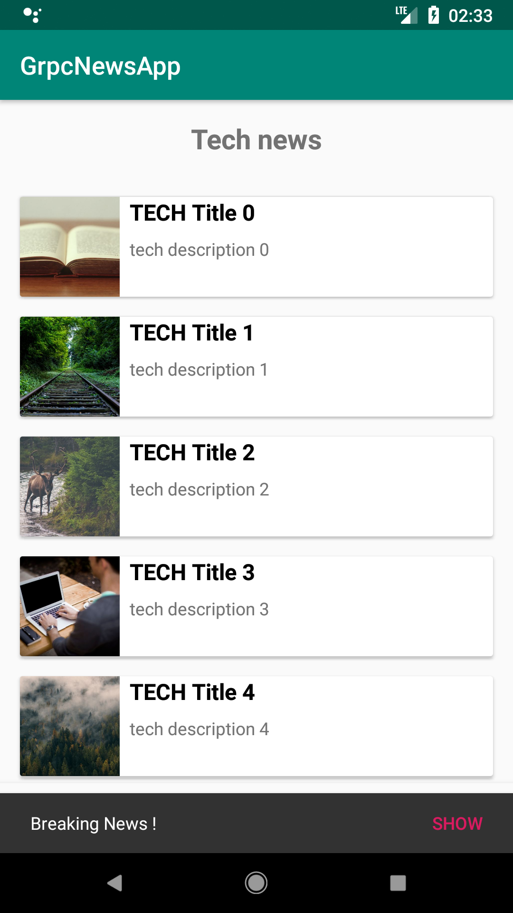

# gRPC Client (Android application)

Android client for `demo.news.v1.NewsService` ([proto](../proto/demo/news/v1/news_service.proto)):

- UI: [Jetpack Compose](https://developer.android.com/compose) with Material 3, a `ViewModel` exposing a `StateFlow`
- gRPC: [grpc-kotlin](https://github.com/grpc/grpc-kotlin) coroutine stubs (`Flow` for the `Subscribe` stream) over
  `grpc-okhttp`, with the protobuf lite runtime
- Images: [Coil](https://coil-kt.github.io/coil/)

The app lists the news by topic (bottom navigation), follows new ones live with a "Breaking news" snackbar,
and publishes news with the + button.

 

## Requirements

- [Android Studio](https://developer.android.com/studio) (or the Android SDK command line tools) with SDK platform 37
- JDK 21: Android Studio bundles one; from the command line, [mise](https://mise.jdx.dev/) installs it (`android/mise.toml`)

## Run

1. Start the server: `mise run server` from the repository root (see the [server project](../backends/kotlin-graal)).
2. Open the `android` folder in Android Studio and run the `app` configuration on an emulator,
   or from the repository root, with an emulator running:

| Command                 | What it does |
|-------------------------|--------------|
| `mise run android:install` | Build and install the debug app on the running emulator or device |
| `mise run android:build`   | Build `app/build/outputs/apk/debug/app-debug.apk` |
| `mise run android:test`    | Run the `NewsViewModel` unit tests (fake repository, no server needed) |

The app connects to `10.0.2.2:6565`, the host machine as seen from the emulator.
For a physical device, pass the address of your machine:
`./gradlew installDebug -PgrpcHost=192.168.1.10 -PgrpcPort=6565`.

## Code layout

| Path | Content |
|------|---------|
| `data/NewsRepository.kt` | The gRPC calls (`GetNews`, `Subscribe`, `PostNews`) behind a small interface |
| `NewsViewModel.kt` | Topic selection, live updates, errors |
| `ui/` | Compose screens |
| `src/generated` | Generated by `mise run generate` (`buf generate`, see [buf.gen.yaml](../buf.gen.yaml)), committed. Do not edit |
