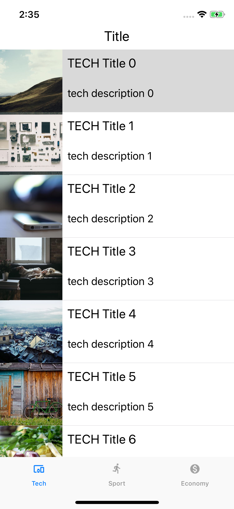
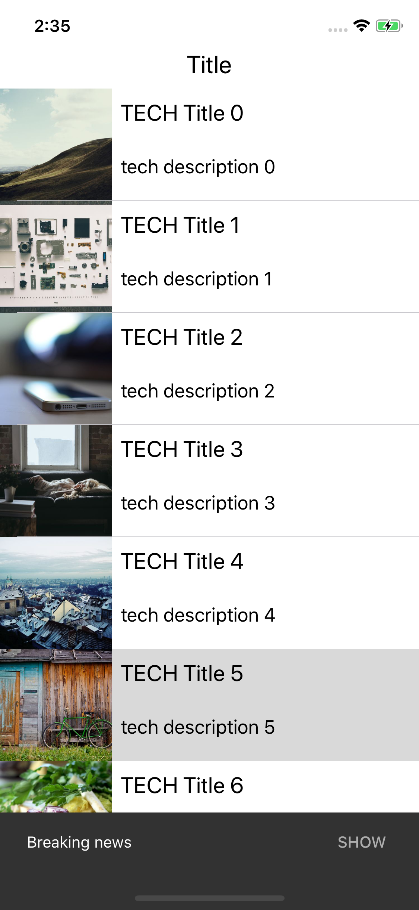

# gRPC Client (iOS application)

iOS client for `demo.news.v1.NewsService` ([proto](../proto/demo/news/v1/news_service.proto)):

- UI: SwiftUI (iOS 18), with `@Observable` state
- gRPC: [grpc-swift 2](https://github.com/grpc/grpc-swift-2) with async/await (`AsyncThrowingStream` for the
  `Subscribe` stream), over the [NIO HTTP/2 transport](https://github.com/grpc/grpc-swift-nio-transport),
  with [SwiftProtobuf](https://github.com/apple/swift-protobuf)
- Dependencies: Swift Package Manager; project: [XcodeGen](https://github.com/yonaskolb/XcodeGen)

The app lists the news by topic (tab bar), follows new ones live with a "Breaking news" banner,
and publishes news with the + button.

 

## Layout

| Path | Content |
|------|---------|
| `NewsKit/` | Swift package with the gRPC logic: generated code, `GrpcNewsRepository`, `NewsViewModel` and their tests. No UI dependency, so it also builds and tests on Linux |
| `GrpcNews/` | The SwiftUI app |
| `project.yml` | XcodeGen description of the Xcode project (the `.xcodeproj` is generated, not committed) |
| `NewsKit/Sources/NewsKit/Generated` | Generated by `mise run generate` (`buf generate`, see [buf.gen.yaml](../buf.gen.yaml)), committed. Do not edit |

## Run

Requires macOS with Xcode 16 or later. [mise](https://mise.jdx.dev/) installs XcodeGen.

1. Start the server: `mise run server` from the repository root (see the [server project](../backends/kotlin-graal)).
2. Generate and open the Xcode project, then run the `GrpcNews` scheme on a simulator:

```sh
mise run ios:project
open ios/GrpcNews.xcodeproj
```

The app connects to `localhost:6565`, which reaches the Mac from the simulator. For a real device, set
`NEWS_SERVER_HOST` in `project.yml` to the Mac's IP address (iOS asks for local network access).

| Command                | What it does |
|------------------------|--------------|
| `mise run ios:project` | Generate `GrpcNews.xcodeproj` |
| `mise run ios:build`   | Build the app for the simulator with `xcodebuild` |
| `mise run ios:test`    | Run the `NewsKit` tests (macOS or Linux). With `NEWS_SERVER_PORT=6565` and a running server, also tests the real gRPC calls |
